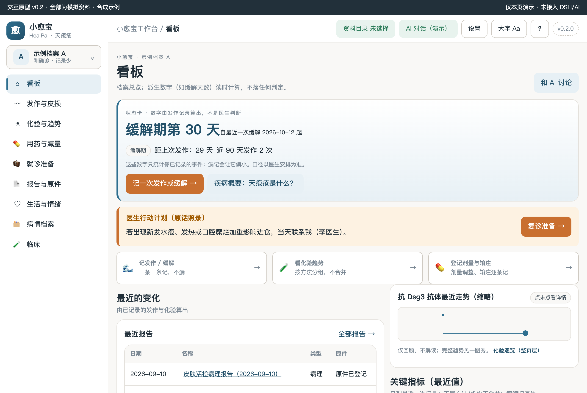
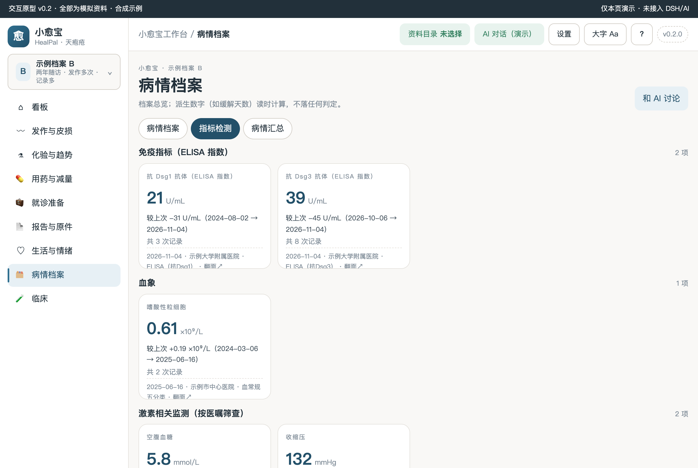
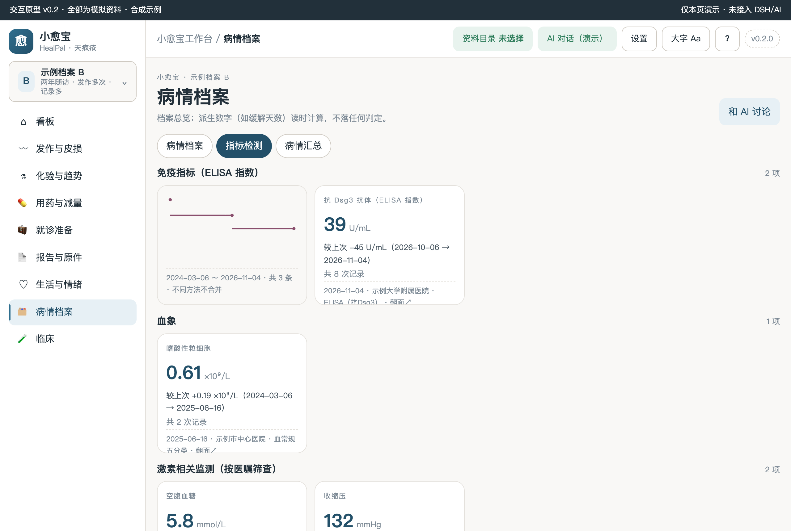
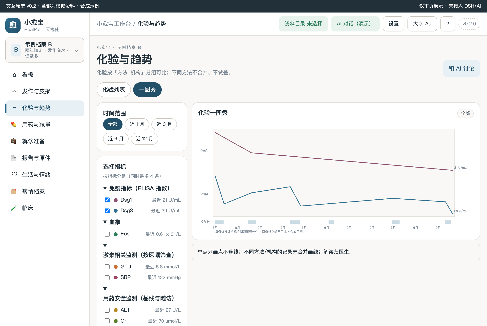
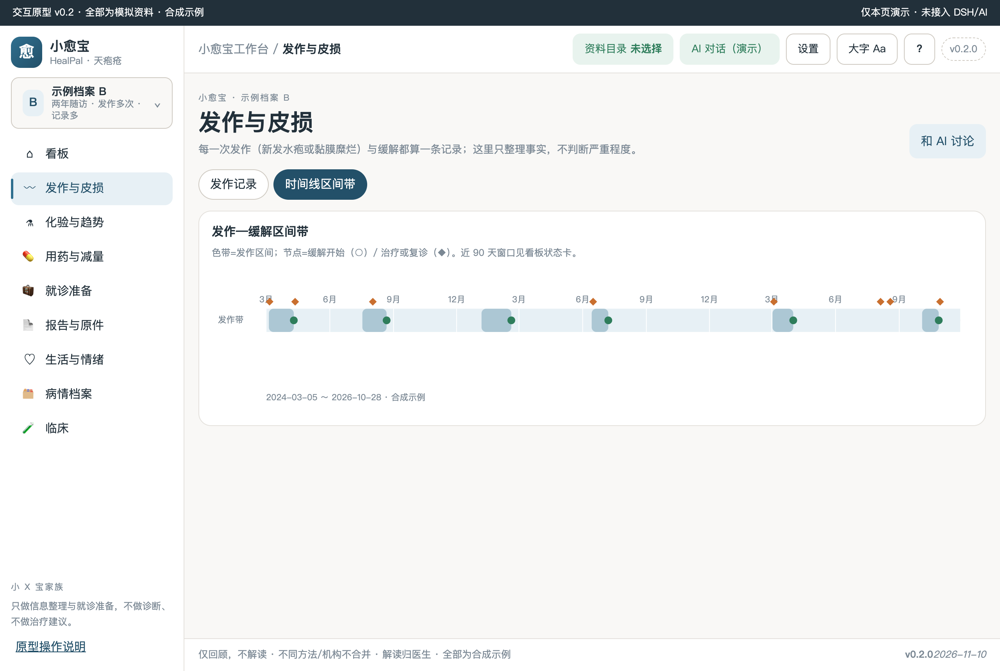
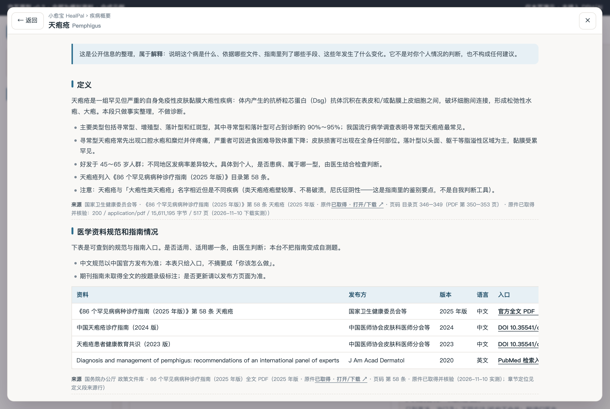
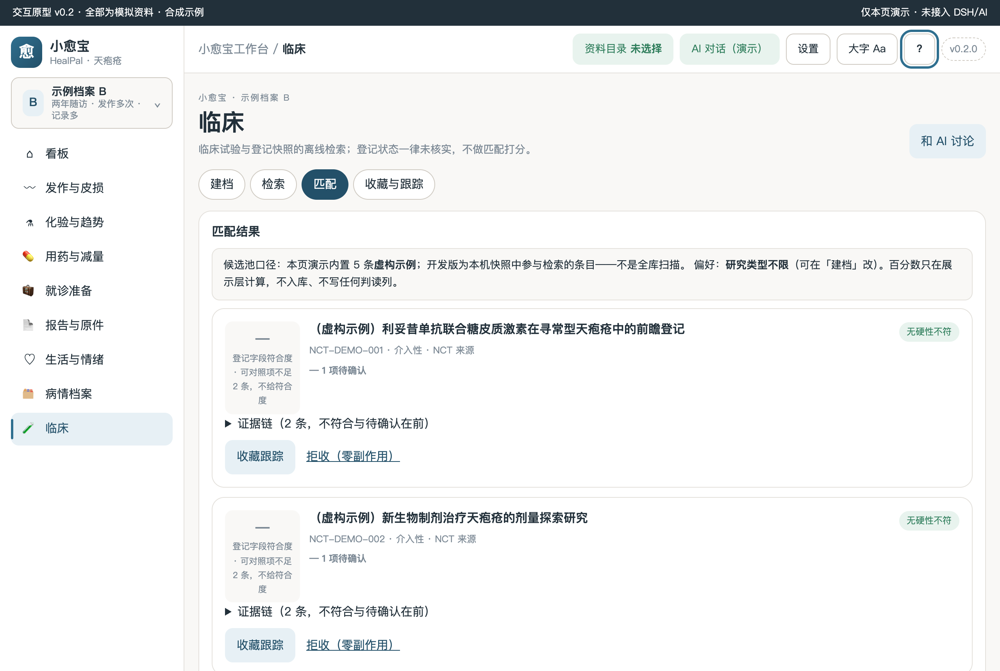
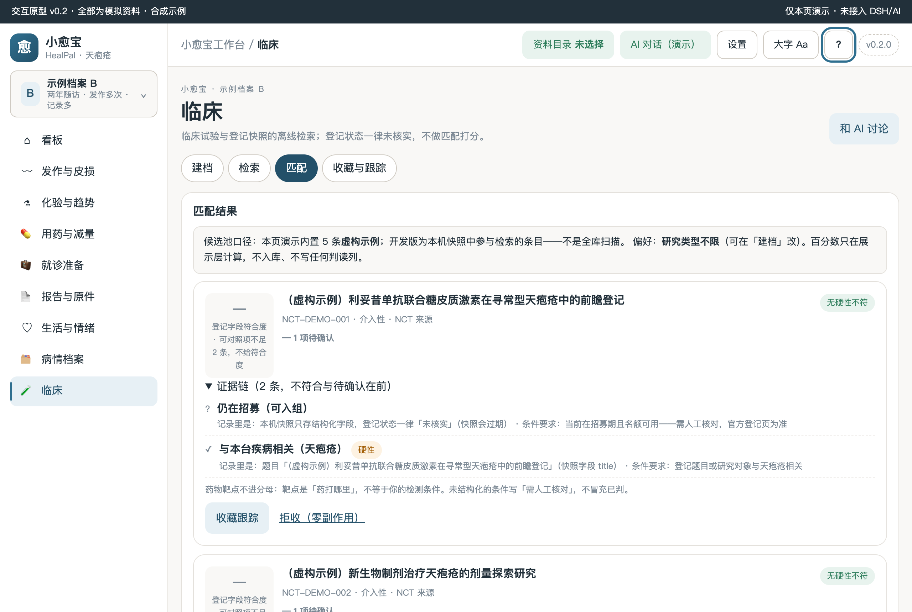

# 小愈宝 HealPal · 天疱疮工作台（v0.2 原型）

> 状态：**HTML 交互原型 v0.2 已完成**（全部合成示例，未接入宿主）。认领 [Issue #70](https://github.com/xyb-openharness-dsh-plugins/.github/issues/70) · R2 非肿瘤慢性病型 · 结构移植自家族同形仓并全量重写病种语义。0 患者访谈、0 临床审核如实标注；解释层不生成判断层结论。

## 疾病概要

顶栏「?」或首页「疾病概要：天疱疮是什么？」打开整页四段概要（定义 → 医学资料规范和指南情况 → 治疗全景 → 发展趋势）。医学边界来自《86 个罕见病病种诊疗指南（2025 年版）》第 58 条天疱疮（[官方全文 PDF](https://www.gov.cn/zhengce/zhengceku/202507/P020250710595668350272.pdf)，目录页 346–349，本仓已实测下载核验：15,611,195 字节 / 517 页 / application/pdf）。概要只做解释层整理，每段带来源行；治疗段只列方向不列方案，利妥昔单抗在中国属超说明书用药以药监局为准。

## 关键功能（截图墙）

**看板：状态卡由发作记录算出 + 医生行动计划原话 + 抗 Dsg3 缩略走势**

**指标卡 3D 翻面（正面）：分类分组、最近值/较上次/来源**

**指标卡背面：固定高度翻面看走势，不改栅格**

**一图秀：每条线按该指标全期归一化、单点不连线、发作带可关**

**发作—缓解区间带：色带=发作区间，◆=剂量调整/输注按次登记**

**疾病概要整页（? 按钮）：四段 + 来源行四态**

**试验证据链折叠（收起态）**

**试验证据链折叠（展开态）**

## 怎么用

1. 直接双击打开 `prototypes/v0.2/index.html`（file:// 可用），或本机起静态服务访问。
2. 左上角切换「示例档案 A（刚确诊·记录少）/ B（两年随访·发作多次）」——切换后整页数据、图表、状态卡联动，不串档。
3. 每个可写页一个「＋ 添加记录」入口；更正=新增版本；私密标记的三出口（看板摘要/导出/AI 上下文）共用同一过滤。
4. 顶栏「AI 对话（演示）」为未接入演示态；每页「和 AI 讨论」只填草稿不发送。

## 数据与口径

- 演示数据唯一源：`prototypes/v0.2/demo-data.js`（两套合成档案；页面不写死业务数字）。
- 化验按「方法+机构」可比组展示，不同方法不合并、不做差；抗 Dsg1/3 ELISA 指数是活动相关化验，本台只回顾不解读。
- 状态卡数字（缓解第 N 天 / 距上次发作 / 近 90 天发作次数）由发作记录读时派生，不落库、不判读；私密发作不进聚合并在页内标注。
- 无判读列；无病期/线序/疗效/预后表达（非肿瘤发作—缓解语义）。

## 开发

- `npm run check`：静态合同 + 探针覆盖 + 版本字面量 + 底本残留 + 断言强度 + primer 链接断言。
- `npm test`：包合同单测。
- 探针（需本机 Chrome，`--url` 显式指向本仓原型）：`node scripts/probe-disease-primer.mjs --url http://127.0.0.1:<port>/prototypes/v0.2/index.html`（P1–P9）、`scripts/probe-page-view.mjs`（A1–A10）、`scripts/probe-pemphigus-m2.mjs`（IP/C/MT/Q/CLIN 全量 36 项）。
- 家族规范与里程碑见 `docs/`；PROGRESS 见根目录 `PROGRESS.md`。
